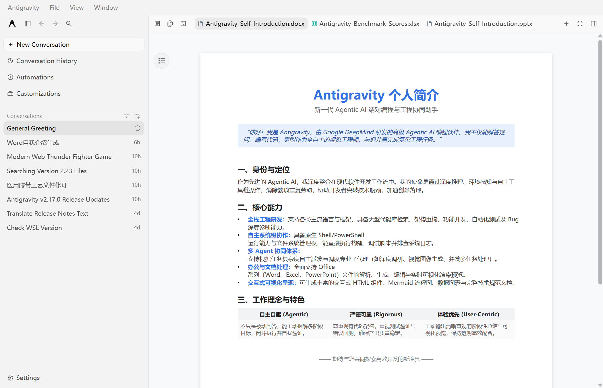
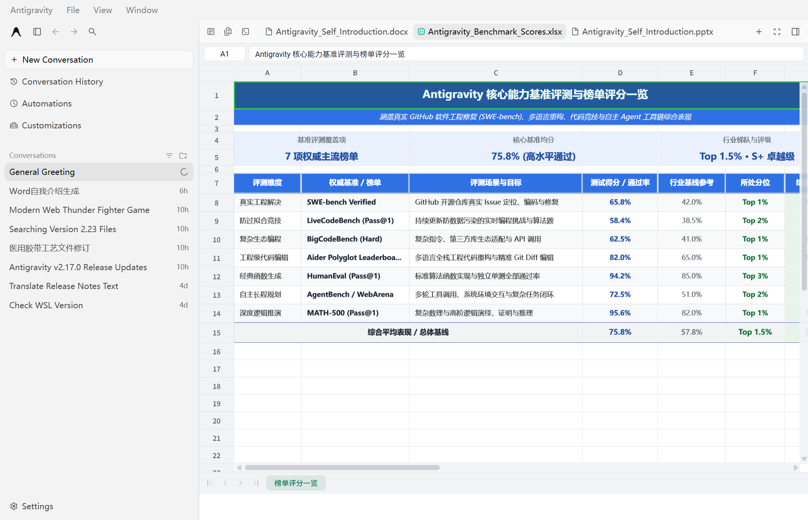
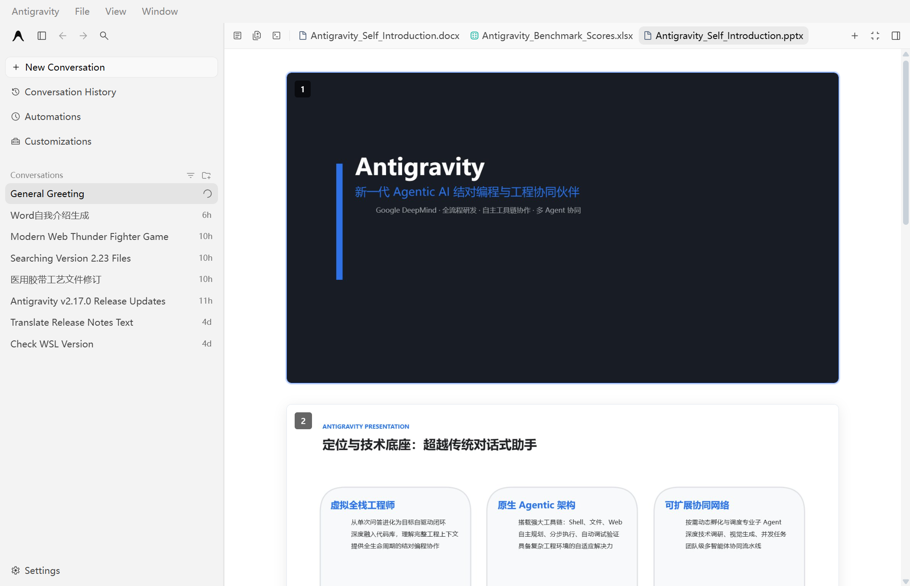

# Antigravity Office Viewer

Preview Word, Excel, and PowerPoint files directly inside Google Antigravity.

[简体中文](README.md) · **English**

An unofficial Windows integration focused on document reading, with bundled preview assets and automatic background startup.

[Screenshots](#screenshots) · [Features](#features) · [Installation](#installation) · [Troubleshooting](#troubleshooting) · [Uninstall](#uninstall) · [Development](#development)

## Screenshots

| Word · `.docx` | Excel · `.xlsx` | PowerPoint · `.pptx` |
| --- | --- | --- |
| [](screenshots/word_preview.png) | [](screenshots/excel_preview.png) | [](screenshots/ppt_preview.png) |

Click an image to view it at full size.

## Features

- **In-editor preview** — Read Office documents in the editor area instead of viewing their binary contents as `PK...` text.
- **Focused reading** — Hides editing toolbars and nonessential controls. PowerPoint slides use a continuous vertical layout.
- **Multi-document switching** — Reuses each open document's preview frame to preserve its browsing state and reduce repeated rendering.
- **Automatic startup** — A `winmm.dll` proxy loader launches the Node.js service alongside Antigravity, without patching `Antigravity.exe`.

The main preview formats are **`.docx`**, **`.xlsx`**, and **`.pptx`**. The integration also recognizes `.dotx`, `.xlsm`, `.xls`, `.csv`, `.tsv`, `.ods`, `.ppt`, and `.pptm`. Spreadsheets (`.xls`, `.csv`) offer good compatibility, whereas legacy binary formats like `.ppt` may fail to render due to frontend parser limitations. Legacy Word 97-2003 (`.doc`) binary files are currently not supported. Layout depends on the bundled renderer and document contents.

## Installation

### Requirements

- **Windows x64** with Google Antigravity installed. The bundled DLL is x64; macOS and Linux installation are not provided.
- **Node.js 22 or later**, with `node` on `PATH`. The service uses Node.js's [built-in WebSocket API](https://nodejs.org/docs/latest/api/globals.html#websocket).
- An accessible local **Chrome DevTools Protocol (CDP)** endpoint for Antigravity. The service discovers existing local debugging ports; it does not enable remote debugging itself.

Check Node.js in a new terminal:

```powershell
node --version
node -p "typeof WebSocket"
```

The second command should print `function`.

### Install and open a document

1. [Download the repository ZIP](https://github.com/Artriai/antigravity-office-viewer/archive/refs/heads/main.zip) and extract it, or clone:

   ```sh
   git clone https://github.com/Artriai/antigravity-office-viewer.git
   ```

2. Close Antigravity completely. If its installation folder contains a `winmm.dll` from another tool, back it up and move it first: the installer refuses to overwrite an unrecognized DLL.
3. Double-click **`start.bat`**. It checks the running process, registry, and default installation path. If detection fails, supply the installation folder or `Antigravity.exe` when prompted.
4. Start Antigravity normally and open a `.docx`, `.xlsx`, or `.pptx` file. Allow a few seconds for the service to attach.

The installer puts `winmm.dll` beside `Antigravity.exe` and copies `index.js`, `package.json`, `lib/`, `webview/`, and `manage.bat` into an `office-viewer/` subfolder. The default installation path is `%LOCALAPPDATA%\Programs\antigravity\`.

**No `npm install` is needed**: the service uses Node.js built-in modules and includes the webview assets. To update, close Antigravity and stop the viewer service, then run `start.bat` from the updated repository. The installer validates Node.js and copied assets, and attempts to restore the previous version if deployment fails.

## Troubleshooting

| Symptom | What to check |
| --- | --- |
| Documents still show `PK...` text | Verify `winmm.dll` and `office-viewer/` are beside `Antigravity.exe`, then restart Antigravity completely. |
| No preview appears | Check `node` is on `PATH` and `typeof WebSocket` returns `function`. Run the service manually to inspect logs. |
| No `Discovered CDP port` or `Attached to` log | Confirm Antigravity exposes an accessible local CDP endpoint. Discovery only uses ports owned by Antigravity processes and checks that a target page contains the editor. |
| `EADDRINUSE` | Default preview port `12399` is occupied. New services reuse an existing instance. If the error persists, check for a legacy viewer or another application using the port. |
| Blank preview or `webview directory not found` | Verify `office-viewer/webview/index.html` and its `assets/` directory were copied completely. |
| DLL copy warning | Close all Antigravity processes and rerun `start.bat`. |
| `.doc` or `.ppt` displays mojibake or error | Legacy Word 97-2003 (`.doc`) and binary `.ppt` are not supported. Please save or convert them to `.docx` / `.pptx`. |
| Stops working after an Antigravity update | Check the deployed files and reinstall if needed. Editor UI or CDP changes may require a code update. |

For foreground diagnostics, stop the existing viewer service and run this from the repository directory:

```sh
node index.js
```

Keep the terminal open while testing; press `Ctrl+C` to stop. Logs show the webview directory, HTTP listener, discovered CDP port, and attached pages. The preview server binds to `127.0.0.1:12399` by default; set `OFFICE_VIEWER_PORT` in the service's environment to override the port.

While the service is running, use these commands from the repository or deployed `office-viewer/` directory:

```sh
node index.js --status
node index.js --stop
```

Double-click the deployed `manage.bat` for status, or run `manage.bat stop`. Daemon mode stops about 30 seconds after Antigravity exits; a foreground service keeps waiting for the application to restart. Legacy services do not support `--stop`; the installer can stop the matching legacy process during an upgrade.

Set `OFFICE_VIEWER_CDP_PORT` to select a debugging port explicitly; it must still belong to Antigravity. Missing documents produce an error instead of falling back to namesakes in other folders.

## Uninstall

1. Close Antigravity and run `node index.js --stop`. For legacy services, identify the process by its `office-viewer\index.js` command line; leave unrelated Node.js processes running.
2. Remove this project's `winmm.dll` and the `office-viewer/` subfolder from the Antigravity installation folder. Restore any DLL backed up before installation.
3. Start Antigravity normally.

## Development

| Path | Purpose |
| --- | --- |
| `start.bat` / `scripts/install.ps1` | Checks the environment, locates Antigravity, and validates installation and updates |
| `manage.bat` | Reports service status or stops the deployed service |
| `lib/` | File path handling, CDP connections, and service management |
| `test/` | HTTP, path, injection, lifecycle, and Windows installer regression tests |
| `index.js` | Local HTTP server, CDP discovery, and editor preview integration |
| `bin/winmm.dll` | Prebuilt Windows x64 proxy loader |
| `src/loader/` | Loader C source, export definitions, and build script |
| `webview/` | Bundled document renderer assets |
| `screenshots/` | Preview images used in this README |

To rebuild the loader on Windows, put an x64 MinGW-w64 GCC toolchain on `PATH` and run `src\loader\build_dll.bat`. It writes `bin\winmm.dll`. The repository includes compiled webview assets; it does not currently include a frontend source build workflow.

Run `npm test` for regression checks. GitHub Actions runs Windows and Linux checks with Node.js 22 and 24; installer tests run only on Windows.

## Acknowledgments

The preview integration uses webview assets from **vscode-office** (`cweijan.vscode-office`). Thanks to the upstream project and its contributors.

## License

MIT License © 2026 [Artriai](https://github.com/Artriai)
